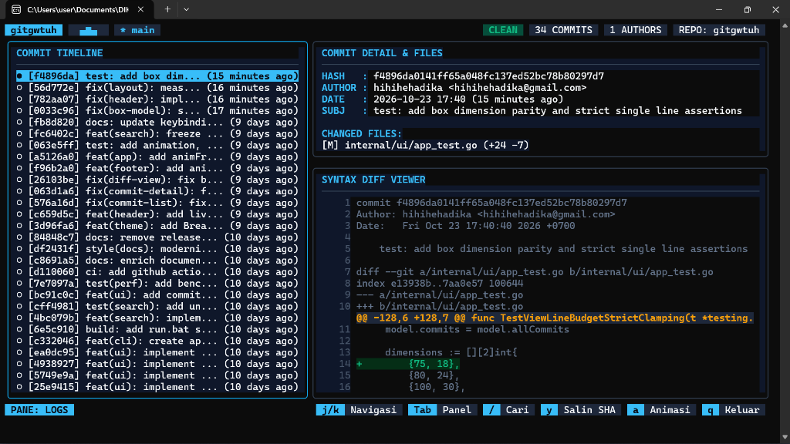

# gitgwtuh

[](https://github.com/hihihehadika/gitgwtuh/actions)
[](https://golang.org)
[](https://github.com/charmbracelet/bubbletea)

A high-aesthetic, keyboard-driven Git TUI explorer and interactive diff viewer built with Go.

<p align="center">
  
</p>

---

## Features

- **Terminal-Native Tiling Layout:** Clean 3-panel display inspired by modern tiling window managers, showing your commit timeline, metadata inspector, and syntax-highlighted code diff simultaneously.
- **Cyber Breathing Glow Animation:** Active panel border pulses with a smooth neon gradient cycle (Cyan to Indigo to Violet) at 10 FPS, zero CPU overhead.
- **Live Telemetry Wave:** Top header displays a real-time block-character pulse (`▂▄▆█▇▅▃`) to signal active repository monitoring.
- **Deep Cosmic Cyber Theme:** Crafted with 24-bit TrueColor ANSI palettes featuring deep slate backgrounds, vibrant cyan accents, and clear status pill badges.
- **Interactive Search Filter:** Instant commit searching by message, author, or hash with `/` shortcut.
- **Clipboard SHA Yanking:** Copy full commit hashes directly to system clipboard using `y`.
- **Pure Go & Zero CGo:** Runs smoothly on Windows Terminal, PowerShell, and Unix shells with zero native library headaches.
- **Vim-Style Keybindings:** Navigate effortlessly using standard keyboard shortcuts (`j`, `k`, `Tab`, `Enter`, `/`, `y`, `a`, `q`).
- **Dynamic Resize Engine:** Automatically recalculates panel bounds on window resize events to keep borders and text crisp.
- **Safe Read-Only Operation:** Inspects commits, branches, and diffs without modifying or risking your repository state.

---

## Keybindings

| Key | Action |
|-----|--------|
| `j` / `Down` | Move down to next commit / file / diff line |
| `k` / `Up` | Move up to previous commit / file / diff line |
| `Tab` | Switch active panel focus (`LOGS` <-> `FILES` <-> `DIFF`) |
| `Enter` | Expand commit details or view file-specific diff |
| `/` | Open live search bar to filter commits |
| `y` | Copy (yank) selected commit hash to clipboard |
| `a` | Toggle animation on / off (battery saver mode) |
| `Esc` | Clear search filter or dismiss active prompt |
| `q` / `Ctrl+C` | Quit and restore terminal screen cleanly |

---

## Quick Start

### Run from Source

```bash
git clone https://github.com/hihihehadika/gitgwtuh.git
cd gitgwtuh
go run ./cmd/gitgwtuh
```

### Build Standalone Executable

```bash
go build -ldflags="-s -w" -o gitgwtuh.exe ./cmd/gitgwtuh
./gitgwtuh.exe
```

---

## Architecture

```
gitgwtuh/
├── cmd/gitgwtuh/         CLI entrypoint and alternate screen lifecycle
├── internal/
│   ├── git/              Git command driver, log parser, and unified diff engine
│   └── ui/
│       ├── styles/       Cosmic theme tokens, colors, borders, and badge styles
│       ├── components/   Header telemetry, commit list, detail card, and diff viewport
│       └── app.go        Bubbletea Model-Update-View application controller
└── README.md
```
